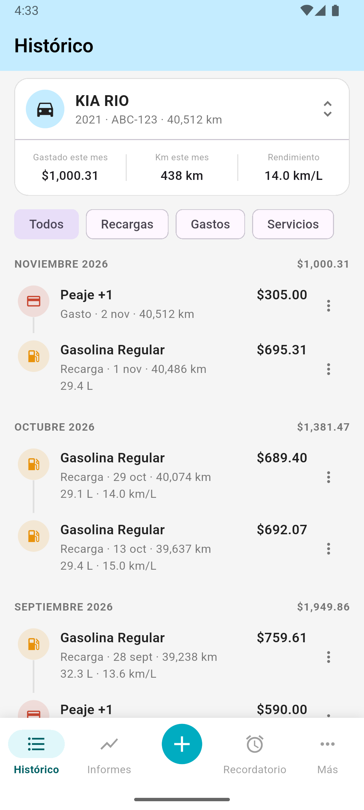
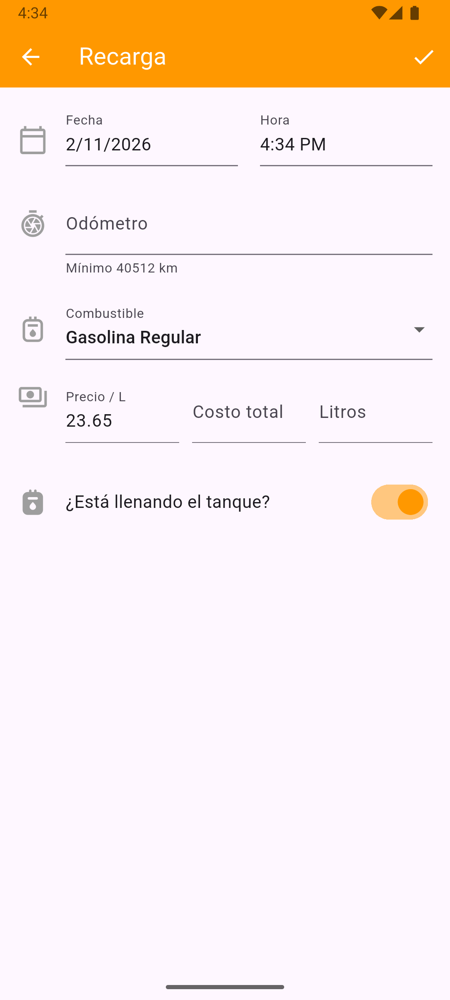
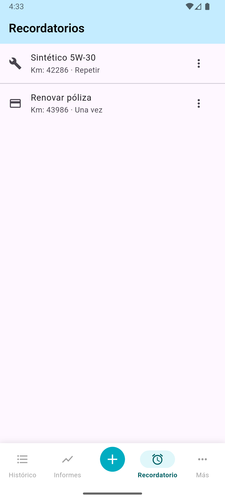
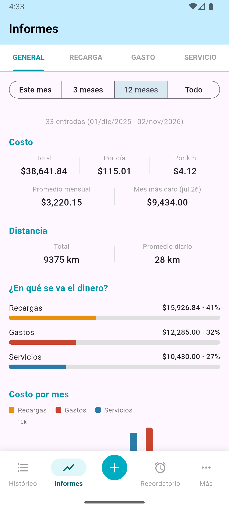
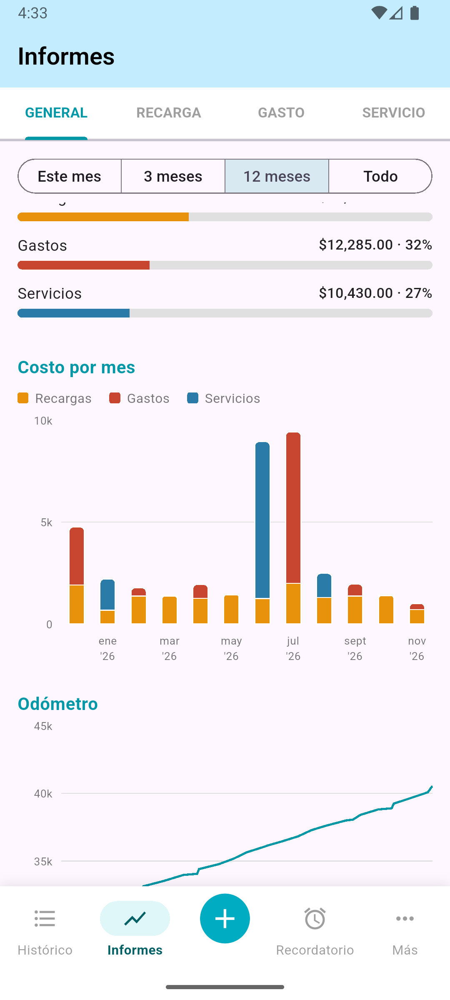
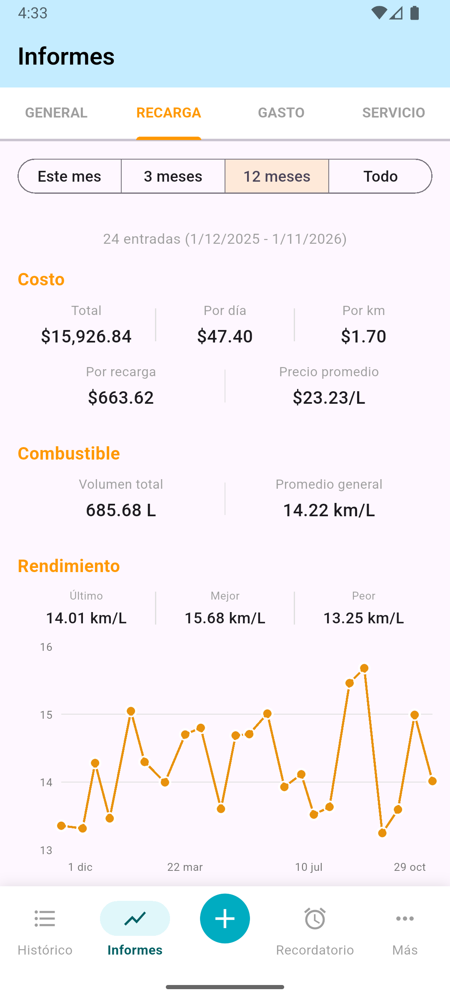

# App Gestión Vehicular

## Descripción
**App Gestión Vehicular** es una aplicación desarrollada en Flutter diseñada para ayudar a los usuarios a llevar un control detallado de sus vehículos. Permite gestionar gastos, recargas de combustible, servicios de mantenimiento y llevar un histórico de actividades, todo almacenado localmente en el dispositivo.

## Capturas de Pantalla
<p align="center">
  
  
  
</p>

<p align="center">
  
  
  
</p>

<p align="center"><sub>Capturas en Android con datos de demostración.</sub></p>

## Funcionalidades

### Inicio
-   Tarjeta del vehículo activo con su odómetro y el resumen del mes: gastado, kilómetros recorridos y último rendimiento.
-   Filtros por tipo: Todos, Recargas, Gastos y Servicios.
-   Movimientos agrupados por mes, con el subtotal de cada uno.
-   Cada movimiento abre su detalle al tocarlo; el menú ⋮ permite editarlo o eliminarlo.
-   Deslizar hacia abajo actualiza la lista, y lo que se registra, edita o elimina aparece sin volver a abrir la pantalla.

### Registros
-   Recargas de combustible, gastos y servicios, con varios conceptos por gasto o servicio.
-   El odómetro se valida contra los registros anteriores y posteriores a la fecha elegida.
-   El rendimiento se calcula de tanque lleno a tanque lleno: las recargas parciales acumulan sus litros hasta el siguiente llenado.

### Informes
-   Pestañas General, Recarga, Gasto y Servicio, cada una con periodos de este mes, 3 meses, 12 meses o todo.
-   Indicadores de costo (total, por día, por km), distancia y reparto del dinero por tipo.
-   Gráficas de costo por mes y odómetro; en recargas, además, rendimiento (último, mejor y peor).

### Recordatorios
-   Por fecha o por kilometraje, de una sola vez o repetitivos.
-   Los de fecha se programan como notificación local; los de kilometraje se evalúan al registrar un movimiento con odómetro.

## Arquitectura
El proyecto sigue una arquitectura **MVVM (Model-View-ViewModel)** complementada con el **Patrón Repositorio** para desacoplar la lógica de negocio y la capa de datos de la interfaz de usuario.

### Capas del Proyecto:

1.  **Model (Modelos - `lib/models/`)**:
    -   Define la estructura de los datos (e.g., `Vehiculo`, `Gasto`, `Servicio`).
    -   Son clases puras de Dart que representan las entidades del negocio.

2.  **View (Vista - `lib/ui/`)**:
    -   Contiene los Widgets y pantallas de la aplicación.
    -   Su única responsabilidad es mostrar datos y capturar interacciones del usuario.
    -   Se suscribe a los cambios en los ViewModels mediante `Provider`.

3.  **ViewModel (Vista-Modelo - `lib/viewmodels/`)**:
    -   Actúa como intermediario entre la Vista y el Repositorio.
    -   Extiende de `ChangeNotifier` para notificar a la UI sobre cambios en el estado.
    -   Contiene la lógica de presentación y manejo de estado (e.g., `VehiculoViewModel`, `RecargaViewModel`).

4.  **Repository (Repositorios - `lib/repositories/`)**:
    -   Define contratos (interfaces) y sus implementaciones para el acceso a datos.
    -   Abstrae la fuente de datos (en este caso, SQLite) del resto de la aplicación.
    -   Ejemplo: `VehiculoRepository` define los métodos y `VehiculoRepositoryImpl` ejecuta las consultas a la base de datos.

5.  **Services (Servicios - `lib/services/`)**:
    -   Preferencias, notificaciones locales y evaluación de recordatorios.
    -   `MovimientosEvents` avisa que un movimiento cambió para que el inicio y los informes se recarguen.

6.  **Data (Datos - `lib/data/`)**:
    -   Contiene `DatabaseHelper`, responsable de la inicialización de la base de datos SQLite y la gestión de conexiones.

## Librerías Utilizadas
Las principales dependencias del proyecto (definidas en `pubspec.yaml`) son:

*   **[flutter](https://flutter.dev/)**: Framework principal para el desarrollo de la UI.
*   **[provider](https://pub.dev/packages/provider)** (`^6.1.2`): Gestión de estado e inyección de dependencias. Se utiliza `MultiProvider` en `main.dart` para inicializar y proveer los ViewModels a toda la app.
*   **[sqflite](https://pub.dev/packages/sqflite)** (`^2.3.3`): Plugin para base de datos SQLite, utilizado para la persistencia local de datos.
*   **[path](https://pub.dev/packages/path)** (`^1.9.0`): Utilidad para manipular rutas de archivos, necesaria para ubicar la base de datos en el dispositivo.
*   **[shared_preferences](https://pub.dev/packages/shared_preferences)** (`^2.3.2`): Almacenamiento persistente simple (clave-valor) para configuraciones ligeras.
*   **[intl](https://pub.dev/packages/intl)** (`^0.19.0`): Para formateo de fechas y números, y soporte de internacionalización (configurado para español 'es').
*   **[flutter_local_notifications](https://pub.dev/packages/flutter_local_notifications)** (`^17.0.0`) y **[timezone](https://pub.dev/packages/timezone)** (`^0.9.3`): Notificaciones locales de los recordatorios.
*   **[fl_chart](https://pub.dev/packages/fl_chart)** (`^0.66.0`): Gráficas de los informes.
*   **[cupertino_icons](https://pub.dev/packages/cupertino_icons)**: Iconos estilo iOS.
*   **[sqflite_common_ffi](https://pub.dev/packages/sqflite_common_ffi)** (`^2.4.0+3`, solo desarrollo): SQLite real en las pruebas.

## Flujo de la Aplicación
El flujo de datos típico sigue estos pasos:

1.  **Interacción**: El usuario realiza una acción en la UI (ej. guardar una nueva recarga de combustible).
2.  **ViewModel**: La UI llama a un método en el `RecargaViewModel`.
3.  **Procesamiento**: El ViewModel valida los datos y llama al método correspondiente en el `RecargaRepository`.
4.  **Persistencia**: El `RecargaRepositoryImpl` utiliza el `DatabaseHelper` para ejecutar la sentencia SQL `INSERT`.
5.  **Notificación**:
    -   La base de datos confirma la operación.
    -   El Repositorio devuelve el resultado al ViewModel.
    -   El ViewModel evalúa los recordatorios por kilometraje, llama a `MovimientosEvents.notificar()` y luego a `notifyListeners()`.
6.  **Actualización UI**: El inicio y los informes recargan sus datos al recibir el aviso, y los widgets que escuchan a los ViewModels (mediante `Consumer` o `context.watch`) se reconstruyen.

## Inicialización
En `main.dart`:
-   Se inicializa el binding de Flutter.
-   Se configura el formato de fechas (`initializeDateFormatting`).
-   Se inicializan las notificaciones (`NotificationService.init()`).
-   Se levanta el `MultiProvider` con todos los ViewModels.
-   Se carga el vehículo activo al inicio (`VehiculoViewModel().obtenerVehiculoActivo()`).

## Pruebas
```bash
flutter test
```

`test/widget_test.dart` sigue siendo la plantilla del contador de Flutter y falla; las demás pruebas cubren el inicio, los informes, el rendimiento y las notificaciones.

## Pendientes
-   Sección Más
-   Reemplazar `test/widget_test.dart`
